### `khaled@github ~ $ ./contributions.sh`

  

### `khaled@github ~ $ whoami`

<table>
  <tr>
    <td valign="top"></td>
    <td valign="top"></td>
  </tr>
</table>

 

<a href="https://khaled-mnejja-portfolio.vercel.app/">Portfolio</a> ·
<a href="https://github.com/khaledmnejja/projet-achat-en-ligne">Online-shopping intent ML project</a>

